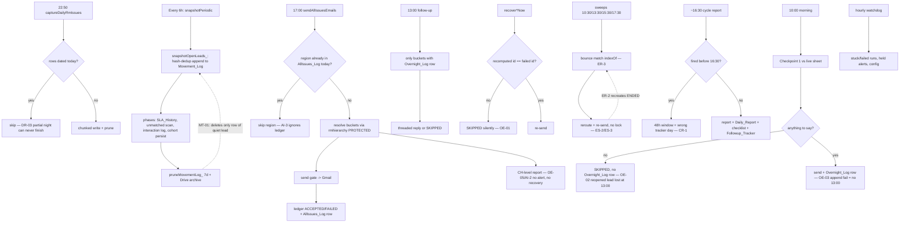

# Code audit — Leads Dashboard Apps Script project (read-only)

**Date:** 2026-10-13 · **Mode:** read-only · **Protected:** `rmhierarchy`
**Repo:** `C:\Users\User\Desktop\Strategy\Google leads Dashboard\` (`master` at `a6d736a` plus this session's uncommitted changes in 6 files: FollowupTracker, StaleLeads, OvernightEmailer, AllIssuesEmailer and two test files).

---

## A. Executive summary

**Scope.** Every line of the 20 production `.gs` files (~13,400 lines) was reviewed. The work was split into six parallel read-only passes, then consolidated, de-duplicated and spot-verified by the lead auditor:

- **Email jobs:** OvernightEmailer, AllIssuesEmailer, EmailInfra
- **Email Ops modules:** EmailLedger, EmailReroute, EmailSweep, CycleReport, DailyChecklist, FollowupTracker
- **Snapshot and stale-lead tracking:** MovementTracker, StaleLeads, LeadFollowupsStaleness
- **Logs:** DailyRmIssueLog, InteractionHistoryLogger, UnmatchedCommentLogger
- **Engines and ops:** Core, FollowupEngine, SlaEngine, OpsAudit, OpsChecklistRunner

**Not reviewed:**
- **Test files** (`Tests_*.gs`) were not audited as code, only used as caller evidence.
- **Browser dashboard** (`js/`): out of scope, except where a `.gs` file mirrors a JS twin.
- **Protected files** (`RmHierarchy.gs`, `RmHierarchy.private.gs`, `RmHierarchySync.gs`): read only to trace their interfaces. No changes are recommended to them.

**Overall health: good.** The code is defensive and heavily commented, and it is backed by about 3,400 tests.
- No duplicate global names exist across the 48 files, and every trigger handler resolves.
- `withRetry_` correctly retries only transient errors and re-throws everything else.
- The JS/GS twins checked (stage rules, SLA constants, outcome-rule signals, RM-performance maths) agree.
- Most defects are in **rarely exercised paths**: recovery, concurrency, retention boundaries and manual one-off tools. The hot paths are mostly sound.

**Most consequential risks:**

1. **OE-01, recovery dead end (High, verified).** The 10:00 and 13:00 recovery runs match failed emails by an ID that contains the recipient address. Following the manual's own fix for a BLOCKED email ("fix the address, then recover") therefore makes recovery skip the email silently, with a misleading reason. The 17:00 job is not affected (its ID has no address).
2. **CR-1, 16:30 report window (High, verified).** The trigger can fire from 16:15. Before 16:30 the report covers about 48 hours and the follow-up tracker evaluates the wrong 17:00 day. A once-a-day guard stops it from ever correcting itself.
3. **CO-1, Drive archive reuse (High if confirmed).** `findIdenticalArchiveFileGs_` never checks `isTrashed()`. A retried prune can treat a trashed archive file as a valid backup and then delete the sheet rows. The only copy is then in Drive Trash, which empties after about 30 days.
4. **Root cause R1, Movement_Log dedup and prune.** Since the content-hash dedup, unchanged leads get no new rows. Several components still assume every open lead has a recent row:
   - The 7-day prune deletes a quiet lead's only row, so stale status and baselines blink off for about a day each week.
   - The backfill tools skip exactly the neglected leads, which is a correctness bug in the manual tools.
   - RM-performance streaks are under-counted, in both runtimes.
5. **Silent failure paths (root cause R4).** Several failures only write to Logger:
   - a failed CH-level report;
   - the consolidated "Leads NOT sent" report itself;
   - an Overnight_Log append that fails after a successful send.

**Highest-value fixes** (all small and outside the protected code): OE-01, CR-1, CO-1, ES-1, ER-2, ER-3, AI-3, and the four alert gaps in R4.

---

## B. Line-by-line audit (findings register)

Severity: C = Critical, H = High, M = Medium, L = Low, I = Info. Confidence: H/M/L.
**✔** = re-verified by the lead auditor; **↓** = downgraded after verification.

### B1. Email jobs: OvernightEmailer.gs (10:00 / 13:00)

| ID | Lines | Function | Finding | Evidence / failure scenario | Sev | Action | Conf |
|---|---|---|---|---|---|---|---|
| OE-01 ✔ | 1245, 1250, 1285–1289; EmailLedger 170–172 | `sendOvernightMorningEmails_` (recovery), and the same pattern at 13:00 | Recovery matches by `emailLedgerIdGs_(job, day, region, role, label, to)`, built from the **current** routing. | A bucket is BLOCKED for a bad address. Following the documented fix (correct the address in Manager_Directory, then recover) changes `to`, so the ID changes. The new bucket is filtered out at 1250 and the old ID is closed at 1288 as SKIPPED ("resolved or routing changed"). The leads are never sent and no alert fires. Any hierarchy change (role or label) has the same effect. | **H** | In recovery mode, also accept a recomputed bucket in a targeted region whose lead set overlaps the failed row's `lead_ids`. At minimum, alert ops instead of a silent SKIPPED. | H |
| OE-02 | 803–810; 2068–2071 | `sendCombinedMorningEmail_` → 13:00 job | A bucket skipped at 10:00 (all resolved) gets no Overnight_Log row, so a lead that reopens by 13:00 is never followed up. | A `reopened` state exists (SlaEngine 275–276), but Section 2 at 13:00 is only reached through Overnight_Log rows. This contradicts the "always a subset" comment at 1561–1568. | M | After pass 2, alert or log any unconsumed `checkpoint1Pending` key that has an active Checkpoint 2 result. | H |
| OE-03 | 889–897, 913 | `sendCombinedMorningEmail_` | If the Overnight_Log append fails **after** a successful send, the error is only logged, yet `checkpoint1_sent_at` is still written. | The 13:00 job then has no thread row, so neither section is followed up. OpsAudit (`ACCEPTED_WITHOUT_LOG`) only notices at 11:15. | M | Call `notifyOpsAlertGs_` in that catch. | H |
| OE-05 / AI-2 | OE 239–255; AI 520–536 | `notifyChLevelLeadsGs_`, `notifyChLevelIssuesGs_` | A CH-level report failing for a normal Gmail reason (not a gate block) produces no alert, never appears in "Leads NOT sent", and has **no recovery path**. Recovery filters on `morning10`/`allIssues17`, while these rows are `chLevel10`/`chLevel17`. | OpsAudit (188–193) points at `recoverFailedAllIssuesBucketsNow()`, which cannot re-send them. | M | Alert on every caught failure. Make OpsAudit say "CH-level: re-send by hand". | H |
| OE-06 | 1321–1365 | `pushUnresolvedToLeadFollowups_` | Read-modify-write of the whole A–H range. | A suggestion typed into column F between the read and the write is overwritten. | L | Write back only the changed rows, or skip column F. | M |
| OE-07 | 526–529 | `sendOneOvernightEmail_` | Test-only legacy function. It writes Overnight_Log without `writeUnlessTestModeGs_` and without try/catch. | Called by hand in TEST MODE, it writes a production row, and the real 10:00 run then skips Section 1 (line 1169). | L | Retire it with its tests, or use the guarded write. | H |
| OE-08 | 2221–2280 | `backfillTodaysOvernightLogRecipientsNow` | Obsolete one-off: the subject format is outdated and it writes in TEST MODE. | — | L | Mark it deprecated. | H |
| OE-10 | 841–842, 1277–1280 | morning failure report | Failure alerts list **all** Checkpoint 1 snapshot leads, including ones already resolved. | Resolved leads are reported as "not sent". | L | Filter with `allIssuesCheckpointIsActiveGs_`. | H |
| OE-11 | 1862–1870 | `sendCombinedFollowupEmail_` | A failed write of `followup_sent_at` is called "harmless" but enables a duplicate reply on a same-day re-run. | — | L | Alert, and correct the comment. | H |
| OE-12 | 677, 1100, 1627, 2027; 1390–1405 | loaders, `waitForFollowupSuggestions_` | Performance: AllIssues_Log and Overnight_Log are read in full every run and are never pruned. The suggestion poll sleeps up to 100 s while holding the script lock. | — | L | Pass the sheet into the loaders and read only the tail rows. | M |
| OE-13 | 1481–1498 | `sendThreadedGmailReply_` | Raw MIME with an unencoded non-ASCII Subject and no Content-Transfer-Encoding. | Hypothesis about rendering only; Gmail normally tolerates it. | L | Reuse the RFC-2047 encoder from EmailInfra 398–400. | M |
| OE-04 | 2345–2346; 2455 | `downloadNoIssueLeadsNow`, `debugFollowupStatusNow` | The diagnostics have drifted from production (scope filter; they ignore Checkpoint 2). | — | L | Use `passesGoogleNonUtmSearchGs_`. | H |
| OE-09 / EI-7 | OE 1191–1198; EI 1186; AI 371–378 | `resolveRecipientEmailsForRegion_` consumers | `trulyUnresolved` is always `[]`, so the consumer loops are dead. | — | I | Leave as a defensive no-op, or remove it together with its callers. | H |
| OE-14, OE-15 | 1954–1958; 2305–2309 | comments and log text | Stale text. | — | I | Update. | H |

### B2. Email jobs: AllIssuesEmailer.gs (17:00) and EmailInfra.gs

| ID | Lines | Function | Finding | Evidence / failure scenario | Sev | Action | Conf |
|---|---|---|---|---|---|---|---|
| AI-3 | AI 317–326, 686–706; EI 970 | `sendAllIssuesEmails_` | The "already sent today" guard reads only AllIssues_Log. | If the log append fails (only logged), or the run dies between the send and the append, a same-day re-run re-sends the whole region. The watchdog hint calls a re-run "safe". | M | Also skip a region that has an ACCEPTED, ATTEMPTING or UNCONFIRMED `allIssues17` ledger row today. | H |
| EI-1 | EI 447–451 | `notifyLeadSendFailuresGs_` | The "Leads NOT sent" report is a single GmailApp call with no retry or fallback. | A Gmail outage that causes the failures most likely also loses this report. | M | Fall back to `sendOpsAlertNowGs_` on error. | H |
| EI-4 | EI 677–678 | `prepareOutgoingEmailGs_` (send gate) | The "lead is in the body" check matches substrings. | Lead `123` counts as present inside `41234`. | L | Match on word boundaries. | H |
| EI-5 | EI 578–605, 718 | `withSendRetry_` / `sendGuardedEmailGs_` | Each retry creates a new draft. | Up to 3 orphan drafts; an operator told to "send the draft" may send duplicates. | L | Delete the orphan before retrying, or say so in the alert. | M |
| EI-6 | EI 968–971 | `checkEmailJobsCompletedGs_` | The hint `job + 'Now'` names functions that don't exist for the sweep jobs. | — | L | Add a per-job manual name. | H |
| EI-8 | EI 1188, 1302–1305 | `loadRegionRecipients_` | Exact, case-sensitive region lookup in Region_Recipients. | A hand-typed "navi mumbai" misses its fallback. | L | Normalise the keys with `normRegionKeyGs_` (caller side only). | H |
| EI-11 | EI 166–177 | `regionPnlHeadEmailGs_` | P&L-head addresses come from Manager_Directory and are not checked by the config watchdog. | A missing P&L Cc is dropped silently every run. | L | Add the P&L names to `emailConfigProblemsGs_`. | H |
| EI-13 | EI 1326 | `readLeadsTab_` | An empty or truncated Leads tab gives zero emails and no alert. | — | L | Alert in the callers when `dataRows.length === 0`. | M |
| EI-2, AI-4 | EI 432, 436; AI 498/513/657 | report text | The 17:00 path uses wording meant for the overnight job; "48h" vs "3 calendar days" contradict each other. | Misleads ops. | L | Fix the strings. | H |
| EI-3 | EI 287–299 | `markChReportSentGs_` | A failed read followed by a write drops the day's earlier CH "sent" marks. | Same-day re-run re-sends them. | L | Skip the write when the read returned `null`. | M |
| AI-1 | AI 343–378, 432 | recovery | A recovery run re-sends an all-regions "Leads NOT sent" report. | Duplicate ops report. | L | Collect failures only when `!recoverIds`. | H |
| AI-6 | AI 565–566 | `sendOneAllIssuesEmail_` | Empty `primaryRole` gives a subject reading "Unmatched RMs ()". | — | L | Omit the empty role. | H |
| AI-11 | AI 385 | ledger ID | The 17:00 ID has no `to`, so two same-label buckets in one region would share a ledger row. | Hypothesis; depends on protected bucketing. | L | Only if observed. Changing the ID scheme affects recovery. | L |
| EI-9, EI-10, EI-12, AI-5, AI-7, AI-8, AI-9, AI-10, AI-12, AI-13 | various | — | Minor: a read path that creates a sheet; MIME encoding on the fallback path; hold-start outside the try; a default `ctx`; stale comments; positional appends; counters; dedup records; one-off tools. | — | L/I | See the agent notes; low value. | — |

### B3. Email Ops modules (ledger, reroute, sweep, report, checklist, tracker)

| ID | Lines | Function | Finding | Evidence / failure scenario | Sev | Action | Conf |
|---|---|---|---|---|---|---|---|
| CR-1 ✔ | CycleReport 40–45, 369–379, 140 | `cycleReportWindowGs_` | `atHour(16).nearMinute(30)` can fire from 16:15. Before 16:30, `lastBoundary` is yesterday, so the window starts **the day before yesterday** at 16:30. | Two 17:00 runs and two mornings are counted together, and `cycleDay` is the wrong day for the follow-up tracker. The once-a-day guard (331–335) prevents a corrected re-send. Tests cover only 16:35, 10:00 and 16:30 exactly. | **H** | When called from the trigger between 16:00 and 16:30, snap to today's 16:30. Add a test at 16:20. | H |
| ES-1 | EmailSweep 190 | `sweepEmailBouncesAndReplies_` | A failed bounce search overwrites an existing `BOUNCED …` status with `UNKNOWN`. | The bounce disappears from the report, checklist J and the tracker's STOP/REROUTED. | M | Keep an existing `BOUNCED` status when the search failed. ES-4 has the same root (the 100-thread cap). | H |
| ER-2 | EmailReroute 268–282 vs 399–407 | `endAllEmailReroutesNow` / `emailRerouteHandleBouncesGs_` | The manual "end all re-routes" is undone by the next sweep, which re-processes 3 days of bounces and only checks for **active** rows. | Up to 4 new ACTIVE rows a day for about 3 days. | M | Don't recreate if any row for that address (including ENDED) is newer than the bounce. | H |
| ER-3 | EmailSweep 79; EmailReroute 392–393 | bounce matching | Addresses are matched with `indexOf`: `raj@…` matches inside `suraj@…`. | The wrong person gets a 14-day re-route and a re-send. | M | Match on address boundaries. | H |
| ER-1 ↓ | EmailReroute 390–394; EmailSweep 78–80 | bounce matching | Feared that every To/Cc in a bounce counts as bounced. | **Checked against a real Gmail bounce (2026-10-10, mailbox): the plain body names only `Final-Recipient`.** The risk is limited to unusual relays. | L | Optional: match only the `Final-Recipient` line. | M |
| ES-2 / ES-3 | EmailSweep 166, 181–214, 239–241; EmailLedger 321–333, 484 | sweep vs prune/append | The sweep runs without the job lock but (a) writes back by row number while the 17:00 job can delete leading rows, and (b) its re-send appends to Email_Ledger concurrently with the jobs. | Values land on the wrong rows, or two appenders compute the same `startRow`. The comment says nothing overlaps; that is wrong. | M | Re-check `email_id` at the write range before writing. Take a short `tryLock` around the re-send and append. | M |
| EL-1 | EmailLedger 345–361; Overnight 2037–2067 | `emailLedgerPlanGs_` | Duplicate IDs within one plan batch are not removed, so the first row stays **PLANNED forever**. | It shows as "unfinished" and recovery keeps targeting it. | M | Skip a plan whose ID is already in `fresh`. | H |
| EL-2 | EmailLedger 347 | `emailLedgerPlanGs_` | `initialStatus` is ignored for an existing row. | A PLANNED row left by a crashed run stays PLANNED on a re-run. | L | Apply `initialStatus` to a still-PLANNED row. | M |
| EL-3 | EmailLedger 598–618 | `releaseHeldIncidentsGs_` | SEND-FAILED rows are never retried; a failed status write re-sends hourly. | — | L | Retry SEND-FAILED with a cap. | H |
| EL-4, EL-9 | EmailLedger 37–47 | `emailLedgerReplaceDayBlockGs_` | A retried `deleteRows` can delete the previous day's rows; a fixed scan span can leave stale rows. | — | L | Re-check the day at `first` before deleting; scan until the day changes. | M |
| EL-6 | EmailLedger 508–623 etc. | tab retention | Incident_Log, Email_Reroutes, Daily_Report, Daily_Checklist and Followup_Tracker are never pruned. Incident_Log is read in full every hour. | Slow growth and cost. | L | Add ledger-style retention, Incident_Log first. | H |
| FT-1 | FollowupTracker 38–41, 76 | `followupTrackerGs_` | The `region\|to` key can merge two 17:00 buckets; comma lists that differ only in spacing don't match. | — | L | Normalise address lists (split, trim, sort). | M |
| FT-2, FT-3 | FollowupTracker 150–157, 173 | reader / record | The day's rows are assumed contiguous; a day with no rows leaves the old block. | — | L/I | Filter within a range; clear the block. | M |
| CR-2, CR-3 | CycleReport 60, 101–102 | `cycleReportDataGs_` | A report overlapping the 17:00 job counts today's job twice; "check failed" is shown as "not checked". | — | L/I | Exclude 17:00 rows planned after 16:30; add a "check failed" count. | M |
| DC-1 | DailyChecklist 118, 127, 136, 142 | `dailyChecklistGs_` | Unreachable GREY branches. | `dailyChecklistCountsGs_` never returns a non-null count with `planned = 0`. | I | Leave. | H |
| DC-2 | DailyChecklist 53, 156 vs manual §5 | `dailyChecklistGs_` | Code and manual disagree: unfinished is RED in the code and AMBER in the manual; serious incidents are AMBER in the code and RED in the manual; 10 vs 30 minutes. | — | L | Decide which is right, then align the other. | H |
| ER-4, ER-5, ER-6, EL-5, EL-7, EL-8, EL-10 | EmailReroute / EmailLedger | — | Fail-open re-send can record the wrong `to`; re-sends repeat when the ledger is off; ENDED rows ignored for history; stale handle after prune; count includes earlier runs; a blank day key stops pruning; incident-ID collisions. | — | L | Small guards (see the agent notes). | M–H |

### B4. Snapshot and stale leads: MovementTracker, StaleLeads, LeadFollowupsStaleness

| ID | Lines | Function | Finding | Evidence / failure scenario | Sev | Action | Conf |
|---|---|---|---|---|---|---|---|
| MT-01 | MT 839–851, 657–669 | `pruneMovementLog_` with dedup | The 7-day prune deletes the **only or latest** row of an unchanged lead (dedup gives such a lead a single row). | The next capture writes a fake "change" row stamped now. The stale flag and "No update since" reset for about 24–30 h every 7 days (SL-01), and `lastSnapshotMap`/`baselineMap` lose the lead until the re-capture. | M | Keep the newest row per `_dedupKeyGs_` even when it has expired. Kept rows go through the full-rewrite path. | H |
| MT-03 | MT 865–889, 914–936 | `pruneMovementLog_` / `snapshotOpenLeads_` | No lock around read → rewrite → clear → shrink. | A concurrent append (dashboard write-back, or `snapshotNow` running alongside the trigger) can be deleted by the shrink. Duplicate appends are also possible. | L–M | `LockService` `tryLock` around the snapshot and prune; compute the shrink from a fresh `getLastRow()`. | M |
| MT-05 | MT 1528–1582 | `removeEarlyCorruptedMovementLogDataNow` | An obsolete one-off using the **clear-then-write** pattern that the file's own incident note blames for data loss. It has no null or empty guards. | Re-running it removes 0 rows but still rewrites the whole sheet; a killed run loses data. | M | Retire it, or return early when `removed.length === 0`. | H |
| MT-04 | MT 657, 707, 733 | `snapshotOpenLeads_` | Movement_Log is read three times per run (overlapping columns) in a job that has hit the 30-minute limit. | — | L | Read the union of needed columns once and pass it on. | H |
| MT-06 | MT 637–639, 1347–1365 | `snapshotPeriodic` | With fewer than 3 lead rows, no Runs row is written but `completed` is recorded. | The two monitors disagree. | L | Write a Runs row with 0 leads. | H |
| MT-07 | MT 168–170 | `_leadContentHashGs_` | Non-Date date fields hash as `''`. | Text dates are invisible to dedup and staleness. Must be changed in lock-step with js/tab-movement.js. | L | Hash `String(v)`, in both runtimes. | L |
| MT-09 | MT 780–782 | `alertSnapshotPhaseFailuresGs_` | A failed alert send is still marked as alerted for the day. | — | L | Mark only on success. | H |
| MT-11 | MT 1153–1157, 1301 | `computeDailyCohortByRegionGs_` | `byKey` is rebuilt for every date: O(dates × rows). | — | L | Build it once. | H |
| MT-02 ↓ | MT 1239–1281 | cohort write-once guard | Feared that date strings become Dates, so the guard never matches. | **Checked live:** Daily_Cohort_History column B matches `'2026-10-10'` as **text** (10 rows). Not reproduced. | I | Optional: normalise on read for safety. | M |
| SL-02 | StaleLeads 64–68 vs 26–31 | `staleSinceForLeadIdsGs_` | Multi-RM leads: "any row stale" here vs "per row" in `staleSinceOfRowGs_`. | The two paths can disagree. | L | Pick one rule. | M |
| LF-01 | LeadFollowupsStaleness 48, 62–67 | `setupLeadFollowupsStalenessFormatting` | Formatting range fixed at A2:H1000. | Rows past 1,000 get no formatting. | L | Use `getMaxRows()`. | H |
| MT-08, MT-10, MT-12, SL-03 | — | — | Repeated number formats; double alert by design; completed one-offs; comments pointing at the wrong file. | — | I | — | H |

### B5. Logs: DailyRmIssueLog, InteractionHistoryLogger, UnmatchedCommentLogger

| ID | Lines | Function | Finding | Evidence / failure scenario | Sev | Action | Conf |
|---|---|---|---|---|---|---|---|
| DR-01 | DR 725–745, 762–802, 880–918 | `backfillDailyRmIssuesFromMovementLog_`, `backfillOneDayFromMovementLog_` | The backfills assume the latest Movement_Log run holds **every** open lead. Since dedup, it holds only the changed ones. | Untouched (neglected) leads are never back-filled, and the partial day then counts as "captured" and cannot be redone. Manual tools only. | H (manual) | Rebuild the latest state per lead as of the cutoff; until then, label the tools unsafe. | H |
| DR-02 | DR 1364–1418; js/core-rm-performance.js 539–557 | `reconstructRmPerformanceObservationsGs_` (+ JS twin) | Same root: no row means no observation, so neglected leads are under-counted and streaks break. | Both twins agree, so both are affected. The size of the effect on real rankings is unproven. | M | Forward-fill the last known row on capture days, in both runtimes together. | H (mechanism) |
| DR-03 | DR 158–170, 237–241 | `captureDailyRmIssues_` | A night that is only partly written can never be completed: any row dated today trips the idempotency guard. | — | M | Write a completion marker after the last chunk and guard on it. | H |
| DR-04, DR-05 | DR 207; 564–567 vs 642–659 | capture / prune | Quiet nights skip the prune; pre-sizing the grid is skipped on an empty tab (the 10M-cell failure mode). | — | L | Re-order; size the grid on the empty path too. | H |
| DR-06, DR-07, DR-08 | DR 789–807, 912–931, 1028–1083 | backfills / repair | Missing the P18c text-format fix; one large `setValues` with no grid sizing; a whole-column rewrite. | — | L–M | Reuse the capture's write helpers. | H |
| DR-09 | DR 617 | `pruneDailyRmIssueLog_` | All dropped rows go into one Drive CSV. | The Drive size limit was hit before elsewhere; a failure here fails the nightly capture. | L | Chunk at 5,000. | M |
| IH-01 | IH 119–134, 213–230 | `logInteractionHistoryGs_` + prune | **Pruned comments are logged again** as new interactions every 30 days: dedup only checks the live tab. | This invents cadence data. | M | Skip comments whose `ts` is older than the retention cutoff. | H |
| UC-01 | UC 169–178, 241–259, 336–352 | scan vs clear/prune | Clearing reviewed rows, or the 30-day prune, **brings the same unmatched comments back as unreviewed**. | The review workflow is undone. | M | Keep a persisted seen-key set, or skip `ts` older than the cutoff. | H |
| IH-02 | IH 105–132; UC 128–177 | dedup keys | The written key and the read-back key can differ (whitespace; a Date-converted cell; spreadsheet timezone). | Hypothesis. | L | Normalise `ts`; write as text. | M |
| UC-02, UC-03, IH-03, DR-10, DR-11, DR-12 | — | — | Clear-then-write in manual tools; mixed-type compare; no `withRetry_`; eligibility copy without a sync note; positional columns; stale comments. | — | L/I | — | H |

### B6. Engines and ops: Core, FollowupEngine, SlaEngine, OpsAudit, OpsChecklistRunner

| ID | Lines | Function | Finding | Evidence / failure scenario | Sev | Action | Conf |
|---|---|---|---|---|---|---|---|
| CO-1 | Core 331–345, 296, 310, 376 | `findIdenticalArchiveFileGs_` / `archiveRootFolderGs_` | No `isTrashed()` check, although the comment says "(not trashed)". | A failed verification trashes its files; on the retry an identical **trashed** file is reused, passes verification, and the prune deletes the sheet rows. The only archive is then in Trash. Also affects RmHierarchySync backups (see §E). | **H** (if DriveApp returns trashed files, as is widely reported) | Add `if (f.isTrashed()) continue;` and skip trashed folders. Core.gs only. | M |
| CO-2 | Core 298–302, 430 | CSV escape | A lone `\r` is not quoted. | Some CSV readers split the row. | L | Add `\r` to the regex. | H |
| FE-1 ✔ | FollowupEngine 188, 100–110 | outcome rules | `'declining'` (typo budget 2) matches **"deciding"** (distance 2, recomputed). | "Client still deciding" is classified as **Call Declined**, with the "avoiding contact" advice. Both runtimes. | M | Make the signal exact, in GS and JS together, plus a regression test. | H |
| FE-2 ✔ | FollowupEngine 249 | outcome rules | `'broker'` matches **"broken"** (distance 1). | "Voice broken" is classified as **CP/Broker**. | M | Same as FE-1. | H |
| FE-3 ✔ | FollowupEngine 262, 281 | outcome rules | `'to let'` matches ordinary phrasing ("asked to let him know…"); `'ringing'` matches **"bringing"**. | Resale advice is "close the lead"; "bringing wife (visit)" becomes Ringing/RNR. | M | Same as FE-1. | H |
| SE-1 | SlaEngine 146–161, 241–286 | `computeSlaFlags_` at the checkpoints | "Behind on Today's Calls" compares calls since midnight with a full-day minimum of 5, evaluated at 10:00 and 13:00. | At 10:00 most leads look "behind", and a lead that was Stuck at 17:00 shows as **ESCALATED** just because the day started. | M | **Product decision:** scale the rule, or exclude it from checkpoint escalation. | M |
| SE-2, SE-3 | SlaEngine 59–61, 83–85; FollowupEngine 54 | GS vs JS | GS accepts only real Date cells; GS counts comment entries without a "Name:" prefix. | The email and the dashboard can disagree on flags. | L–M | Align the parsing with JS `parseDate` and `parseActionLog`. | M–H |
| FE-4, FE-5 | FollowupEngine 506–509; 454–737 | modifiers / port | "after 2 days" is read as a specific time; the email's follow-up text differs from the dashboard's. | — | L | Tighten the regex; document the intended differences. | H |
| OC-1 | OpsChecklistRunner 154–243 | `buildWeeklyOpsChecklistSummary_` | One failing check aborts the whole weekly email. | — | L | Wrap each check in try/catch. | H |
| OC-2, OC-3, OA-1, OA-2, SE-4, X-1 | — | — | Project timezone not confirmable (no appsscript.json locally); last row wins; legacy Futwork rows; double alert; redundant condition; stale comments. | — | L/I | — | L–H |

**Sections reviewed with no findings** (coverage evidence):
- Core stage classification (it matches its JS twin);
- `withRetry_`;
- `withEmailJobLockGs_`;
- `renderOvernightReportEmailHTML_` (everything is escaped);
- `appendRowOnceGs_` / `jsonForCellGs_`;
- the held-alerts pipeline;
- `splitStaleSectionsGs_` (band logic traced);
- `allIssuesWindowGs_` (IST anchoring correct);
- the DailyRmIssueLog date-integrity helpers;
- the RM-performance maths (constant-by-constant match with JS);
- OpsAudit column indexes;
- trigger setups (each deletes its own old trigger first, so no duplicates).

---

## C. Logic and control-flow map

**Termination and error paths:**
- Every trigger entry point uses the pattern "alert ops, then re-throw", and the run is recorded as failed for the watchdog.
- **Dead ends:** OE-01 (recovery), DR-03 (partial night), OE-02 (a lead reopened after a skipped 10:00 checkpoint), and CH-level failures (OE-05/AI-2).
- **Unreachable code:** the DailyChecklist GREY branches (DC-1) and the `trulyUnresolved` loops (OE-09/EI-7).

---

## D. Function inventory

Built from a script over all 48 files: definitions, references in code (comments stripped), trigger and menu registrations, and string references.

| Metric | Result |
|---|---|
| `.gs` files / functions | 48 / 634 (494 production) |
| Duplicate function names (would silently override in Apps Script) | **none** |
| Duplicate top-level `const`/`let`/`var` | **none** |
| Trigger and menu handlers | 9 registered by `newTrigger` (snapshotPeriodic, captureDailyRmIssues, sendAllIssuesEmails, sendOvernightMorningEmails, sendOvernightFollowupEmails, sendEmailCycleReport, emailJobWatchdog, runWeeklyOpsChecklistNow, syncRmHierarchyNightly), plus spec-driven ones (OpsAudit `spec.job`, the sweep handlers). All resolve. |
| Production functions with **zero** references | **none** |
| Manual entry points (`…Now`, `setup…`, `run…`) | 38 |

**Status by function group** (full per-function tables are in the agent sections behind §B):

| Status | Functions | Evidence |
|---|---|---|
| **Potentially unused (only tests call them)** | `sendOneOvernightEmail_` (OE-07), `allIssuesRecoveryTargetsGs_`, `allIssuesLateCutoffPassedGs_` (production calls `emailLedgerRecoveryTargetsGs_` directly), `emailLedgerSkipGs_`, `cycleFreshnessLevelGs_` | Only `Tests_*.gs` references them. They can't be manual entry points (trailing `_`). |
| **Manual one-offs, probably finished** | `removeEarlyCorruptedMovementLogDataNow` (MT-05), `removeDedupIncidentRowsNow`, `removeStaleMovementLogBackupTabNow`, `removeTestModeAllIssuesRowsNow`, `dedupeUnmatchedCommentsNow`, `backfillTodaysOvernightLogRecipientsNow` (OE-08), `repairDailyRmIssuesMissingFieldsNow`, `removeOppConversionTrackingTabNow` | Only the Run dropdown can call them. Whether they are still needed can't be told from code; it needs the owner. |
| **Manual diagnostics, used** | `show…Now`, `debugFollowupStatusNow`, `downloadNoIssueLeadsNow`, `reportRmPerformanceNow`, `reportWorkbookCellUsageNow`, `prune…Now`, `recover…Now` | By convention; several are named in OpsAudit and checklist text. |
| **Duplicate / redundant** | `unmatchedCommentDedupKeyGs_` ≡ `commentHistoryDedupKeyGs_` (byte-identical); `computeRmPerfEligibilityGs_` copies the `computeSlaFlags_` eligibility (DR-10) | Code comparison. |
| **Used** | all others | Production callers or trigger registration found. |

**Cannot be determined from the supplied context:** whether the Run-dropdown one-offs are still needed, and the live trigger list. Triggers are created by `setup…` functions, so which ones are installed now must be checked in the Apps Script **Triggers** page.

---

## E. Conflict and dependency register (shared root causes)

| Root | Findings | Shared cause |
|---|---|---|
| **R1** Movement_Log dedup | MT-01, SL-01, DR-01, DR-02 (+ the SlaEngine baseline, noComment) | Content-hash dedup changed the meaning of "latest row / latest run". Consumers still assume a recent row exists for every open lead. |
| **R2** Ledger identity keys | OE-01, AI-11, EL-1, FT-1 | IDs mix routing output (`to`, role, label) with identity, so routing changes break matching, and batches are not de-duplicated. |
| **R3** Lock model | MT-03, ES-2, ES-3, OE-06 | Only the email jobs take the script lock. The snapshot, the sweep, the prune and the dashboard write-back all write the same tabs without one. |
| **R4** Silent failures | OE-03, OE-05/AI-2, EI-1, OE-11, MT-09, EI-13, OC-1 | A catch that only logs, on paths where nobody reads Logger. |
| **R5** Dedup only against the live tab | IH-01, UC-01 | Pruned or cleared rows look "new" again. |
| **R6** Substring matching | ER-3, EI-4 (ER-1 checked, low) | `indexOf` on addresses and IDs. |
| **R7** GS/JS twins | FE-1–3 (both runtimes), FE-5, SE-2, SE-3, DR-10, MT-07 | Mirrored logic; fixes must land in both runtimes. |
| **R8** Unbounded growth and repeated reads | EL-6, OE-12, MT-04, MT-11 | No retention on newer tabs; full-history reads every run. |
| **R9** Clear-then-write in manual tools | MT-05, UC-02, DR-08 | A pattern the project's own incident notes ban. |
| **R10** Code/manual/comment drift | DC-2, OE-14/15/16, AI-4/7, EI-2, SL-03, DR-12, X-1 | Comments and the manual not updated with behaviour changes. |

**Competing sources of truth:**
- P&L Cc comes from Manager_Directory, while leadership and ops addresses come from the private table (EI-11).
- AllIssues_Log and Email_Ledger both act as the "already sent" record (AI-3, OE-03).
- The 16:30 report and DailyChecklist disagree with the manual (DC-2).

**Repository hazards** (not code defects):
- Stale copies exist in `working files on 28th for automatic email\` and `.claude\worktrees\serene-chaplygin-6a5170\`. If either were ever pasted or pushed into the project, it would add duplicate globals that silently override live functions. Keep them out of any deploy.
- **Runtime observation** from the bounce check: `yash.sharma@`, `amit.upadhyay@` and `vemula.ajay@` all bounced with "address not found / inactive" (9–10 Oct). For Vemula Ajay this matches today's HR update. The other two are worth checking in Manager_Directory.

### rmhierarchy touchpoints (protected: observations only)

| Caller | Lines | Protected item | Role |
|---|---|---|---|
| EmailInfra | 1179 | `resolveRecipientBucketsForRms_` | main bucket resolution (inside `withRetry_`) |
| EmailInfra | 68–69, 138–151, 173, 1194 | `lookupEmployeeEmail_`, `ALWAYS_CC_EMAILS_`, `LEADERSHIP_NAMES_`, `alwaysCcEmailsGs_`, `loadRmHierarchyAndEmails_` | address lookup, leadership Cc, P&L fallback (two-way dependency with `resolvedEmailForNameGs_`) |
| AllIssuesEmailer | 218 | `loadRmHierarchyAndEmails_` | loaded once per run |
| OvernightEmailer | 991, 2233, 2293, 2494, 2500–2507 | `loadRmHierarchyAndEmails_`, `setupRmHierarchy`, `lookupRmChain_` | loading, setup, debug trace |
| EmailReroute | 320, 169–191 | `loadRmHierarchyAndEmails_` | next-hop for bounce re-routes |
| OpsChecklistRunner | 158, 168 | `auditUnresolvedRms_`, `auditManagerDirectoryEmailGaps_` | weekly checks |
| DailyRmIssueLog | 1255 | `RM_HIERARCHY_SHEET_` | read-only role lookup |

**Observations, with no change recommended:**
- **OE-16:** comments disagree about whether a CH-tier primary goes to ops or is a normal recipient. Only the protected resolver decides; the comment owner should confirm.
- `emailRerouteNextGs_` falls back to ops when the dead person has no row of their own, and does not consider `excluded`.
- `buildRmHierarchyRoleByNameLowerGs_` ignores `excluded`, and for duplicate names the last row wins.
- **CO-1:** the fix sits in Core.gs, but `RmHierarchySync` backups use `archiveRowsToDriveCsv_`, so the fix **indirectly changes protected backup behaviour**. It only makes a trashed file ineligible for reuse; it does not change any hierarchy logic. Flagged for your sign-off.
- **EI-8 / EI-11** touch the callers' handling of the resolver's output (region fallback, P&L check). They do not change what the resolver returns.

**Boundary question for you:** I treated `RmHierarchySync.gs` (the nightly HR sync) as protected along with `RmHierarchy.gs` and `RmHierarchy.private.gs`. If you meant only `RmHierarchy.gs`, the sync file still needs its own audit.

---

## F. Prioritized optimization plan (no change to rmhierarchy)

**P0: critical correctness or security.** No Critical findings. No credentials, injection or security issues were found. HTML output is escaped and recipient checks run through the send gate.

**P1: high-impact logic and reliability**

| # | Finding | Lines | Problem / root cause | Proposed change | Benefit | Regression risk | Prerequisites | Verification | Effort |
|---|---|---|---|---|---|---|---|---|---|
| 1 | OE-01 | Overnight 1245–1289; 13:00 equivalent | Recovery ID includes routing (R2) | In recovery mode, match a recomputed bucket by region plus lead overlap; alert when a targeted ID is unmatched but leads remain | The documented fix procedure works | Low: only recovery mode changes | none | New tests: address fixed, then recover, then sent; routing changed, then alert | S–M |
| 2 | CR-1 | CycleReport 40–45 | Window boundary depends on firing time | Snap to today's 16:30 when 16:00 ≤ now < 16:30 | A correct daily report and tracker day | Low | none | Tests at 16:15, 16:20, 16:29, 16:30, 16:45 | S |
| 3 | CO-1 | Core 331–345 | Trashed files are reused as archives | Skip `isTrashed()` files and folders | No silent loss of pruned rows | Very low. ⚠ indirectly affects RmHierarchySync backups; needs sign-off | Your OK on the boundary | Mock a trashed identical file, then expect a new file | S |
| 4 | ES-1 (+ES-4) | EmailSweep 190 | A failed search overwrites BOUNCED | Keep an existing `BOUNCED…` status | Bounces stay visible | Very low | none | Test: BOUNCED row plus search failure | S |
| 5 | ER-3 | EmailSweep 79; EmailReroute 392 | `indexOf` on addresses | Match on address boundaries | No wrong re-routes | Low | none | Test raj vs suraj | S |
| 6 | ER-2 | EmailReroute 399–407 | ENDED rows are ignored | Don't recreate a row older than the latest ENDED row | The manual override sticks | Low | none | Test: end all, then sweep, then no new row | S |
| 7 | R4 bundle: OE-03, OE-05/AI-2, EI-1, OE-11 | listed in B | Catch blocks only log | Add `notifyOpsAlertGs_` (held, so cheap); OpsAudit message for CH-level | No silent loss | Very low: extra alerts only | none | Tests using the existing alert mocks | S |
| 8 | AI-3 | AllIssues 317–326 | The guard ignores the ledger | Also skip regions with ACCEPTED, ATTEMPTING or UNCONFIRMED ledger rows today | No duplicate 17:00 emails after a crash | Low | Ledger live | Test: ledger ACCEPTED, no log row, re-run, no send | S |
| 9 | EL-1 | EmailLedger 345–361 | No de-dup within a batch | Skip IDs already in `fresh` | No permanently PLANNED rows | Very low | none | Test: duplicate plan | S |
| 10 | FE-1–3 | FollowupEngine 188, 249, 262, 281 + JS twin | Fuzzy matches on short words | Make those signals exact or remove them, in **both** runtimes | Correct follow-up advice | Medium: classification shifts | Decide on wording | Regression tests: "deciding", "broken", "bringing", "to let him know" | S–M |
| 11 | MT-01 (R1) | MovementTracker 839–851 | Prune removes a quiet lead's only row | Keep the newest row per key | Stable stale flags and baselines | Medium: touches the prune paths | none | Tests: a 10-day-quiet lead survives the prune; stale date unchanged | M |
| 12 | DR-01 | DailyRmIssueLog 725–918 | Backfill reads only the last run | Latest row per lead as of the cutoff; meanwhile label the tools unsafe | Correct backfills | Low (manual tools) | none | Test with dedup-shaped history | M |
| 13 | IH-01, UC-01 (R5) | listed | Re-logging after prune or clear | Skip comments older than the retention cutoff | No fake interactions; reviews stay done | Low | none | Test: prune, then scan, then nothing new | S–M |
| 14 | SE-1 | SlaEngine 146–161 | Full-day call rule at 10:00 | **Product decision** first | Fewer false "ESCALATED" | Medium | Your decision | Checkpoint tests at 10:00 | S |

**P2: performance and maintainability.**
- DR-03 (completion marker)
- ES-2/ES-3 and MT-03 (short `tryLock` and row-ID re-check, R3)
- MT-04 (one Movement_Log read per snapshot)
- EL-6 (retention for Incident_Log and the reporting tabs)
- OE-12 (tail reads of the logs)
- DR-04/05/06/07/09 (capture and prune hardening)
- SE-2/SE-3 (GS/JS parsing alignment)
- EI-4, EI-11, EI-13, OC-1
- DC-2 (align the manual with the code)
- MT-05 (retire it, or add a guard)

**P3: optional cleanup.**
- Retire finished one-offs (§D) together with their tests.
- Remove the test-only wrappers.
- Merge the duplicate dedup-key function.
- Correct stale comments (R10).
- Fix the remaining Low/Info items (AI-1/4/6, EI-2/3/5/6/8/9/10/12, EL-2/3/4/5/7–10, ER-4–6, FT-1–3, CR-2/3, MT-06/07/09/11, SL-02, LF-01, CO-2, FE-4/5, OA-1/2, OC-2/3).
- Move or delete the stale repository copies of the `.gs` files.

---

## G. Validation plan

1. **Full suite:** `python test/run-gs-tests-headless.py` must stay green (currently 3,401/3,401). Add the regression tests listed in §F for each item you take on.
2. **Edge cases to add as tests:**
   - report trigger at 16:15–16:29;
   - recovery after an address fix;
   - recovery after a role or label change;
   - a trashed identical archive file;
   - bounce search failure with an existing BOUNCED row;
   - `raj@` vs `suraj@`;
   - "end all" followed by a sweep;
   - duplicate plan IDs;
   - a lead quiet for more than 7 days across a prune;
   - partial night write;
   - comment re-scan after prune or clear;
   - the classification phrases in FE-1–3 (run in **both** the GS suite and `tests/frontend-harness.html` for the JS twin).
3. **Integration checks (live, read-only):**
   - after the CR-1 fix, compare one Daily_Report row against the ledger counts for the same 16:30-to-16:30 window;
   - after OE-01, rehearse recovery in TEST MODE.
4. **Performance:** compare `snapshotPeriodic` `totalSeconds` in Movement_Log_Runs before and after MT-04 (7-day median), and Incident_Log read time before and after EL-6.
5. **rmhierarchy unchanged:**
   - `Tests_RmHierarchy.gs` and `Tests_RmHierarchySync.gs` must pass unmodified;
   - `git diff --stat -- RmHierarchy.gs RmHierarchy.private.gs RmHierarchySync.gs` must be empty for every change in this plan;
   - re-run the 245-row RM_Hierarchy checksum comparison (local vs the live tab) after any deploy;
   - for CO-1 specifically, run an RmHierarchySync backup in TEST MODE and confirm a backup file is still produced.

---

## H. Final safety check

- **No source code was edited by this audit.** The six review passes were read-only (grep and read). The lead auditor ran only a read-only Python inventory script and read-only data checks: one Gmail bounce thread, and gviz queries on Daily_Cohort_History. No tests were executed as part of the audit.
- **Separate from the audit:** this session's earlier, already-approved changes (the stale-lead tile and the follow-up tracker) are still **unsaved in your Apps Script editor** and uncommitted in the repo. The audit covers the working tree including those changes.
- **rmhierarchy:** treated as protected. `RmHierarchy.gs`, `RmHierarchy.private.gs` and `RmHierarchySync.gs` received no recommendations. The one indirect effect (CO-1 on the sync's backups) and the boundary question are flagged in §E.
- **Traceability:** every finding cites file:line from code that was read. Hypotheses are labelled (Confidence L/M). Two were checked against live data and downgraded (ER-1, MT-02). Four High or Medium claims were re-verified by the lead auditor (OE-01, CR-1, FE-1–3).
- **Missing context:**
  - no local `appsscript.json` (project timezone unconfirmed);
  - the live trigger list was not read;
  - Drive's behaviour with trashed files was not tested (CO-1);
  - real-world frequency of the concurrency races is unknown.
- **Correctness vs optional:** P1 items are correctness and reliability fixes. P2 is performance and maintainability. P3 is optional cleanup. SE-1 and DC-2 need a product decision before any code change.

## Status (2026-10-15)

Copied from the To-do Dashboard folder on 2026-10-15; the report above is unchanged. This table records what the
audit-fix commits on `master` did with each finding (merged in `bd27cc2`..`a7d9e12`, follow-up `1f51394`; not pushed
at the time of writing). Built from the commit messages and the finding-ID comments in `*.gs` / `js/*.js`.
**None of the `.gs` changes is live until pasted into the Apps Script editor** (see `docs/STALENESS_TRACKER.md`).

Commits: `0e9f31d` group A (OvernightEmailer), `09eb9ca` group B (AllIssuesEmailer + EmailInfra), `7ef68d3` group C
(Email Ops modules), `2146e13` group D1 (MovementTracker, StaleLeads, LeadFollowupsStaleness), `450565a` group D2
(DailyRmIssueLog, InteractionHistoryLogger, UnmatchedCommentLogger, js/core-rm-performance.js), `8ef279d` group E
(Core, FollowupEngine, SlaEngine, OpsAudit, OpsChecklistRunner, js/core-outcome-engine.js).

| Finding | Status | Commit | Note |
|---|---|---|---|
| OE-01 | DONE | `0e9f31d` |  |
| OE-02 | DONE | `0e9f31d` |  |
| OE-03 | DONE | `0e9f31d` |  |
| OE-04 | DONE | `0e9f31d` |  |
| OE-06 | DONE | `0e9f31d` |  |
| OE-07 | DONE | `0e9f31d` |  |
| OE-08 | DONE | `0e9f31d` |  |
| OE-10 | DONE | `0e9f31d` |  |
| OE-11 | DONE | `0e9f31d` |  |
| OE-12 | DONE | `0e9f31d` |  |
| OE-13 | DONE | `0e9f31d` |  |
| OE-14 | DONE | `0e9f31d` |  |
| OE-15 | DONE | `0e9f31d` | stale setup log text (per the commit message; no finding-ID comment in the code) |
| OE-05 | DONE | `0e9f31d, 8ef279d` | alerts on every CH-level failure (A); OpsAudit says "re-send by hand" (E) |
| AI-2 | DONE | `09eb9ca, 8ef279d` | same as OE-05, 17:00 side |
| OE-09 | SKIPPED | - | `trulyUnresolved` loops left as a defensive no-op (audit: "leave") |
| OE-16 | SKIPPED | - | comment disagreement inside the protected RM-hierarchy resolver; the owner must confirm |
| AI-1 | DONE | `09eb9ca` |  |
| AI-3 | DONE | `09eb9ca` |  |
| AI-4 | DONE | `09eb9ca` |  |
| AI-5 | DONE | `09eb9ca` |  |
| AI-6 | DONE | `09eb9ca` |  |
| AI-7 | DONE | `09eb9ca` |  |
| AI-9 | DONE | `09eb9ca` |  |
| AI-8 | SKIPPED | - | minor / info, low value (audit: "see the agent notes") |
| AI-10 | SKIPPED | - | minor / info, low value (audit: "see the agent notes") |
| AI-12 | SKIPPED | - | minor / info, low value (audit: "see the agent notes") |
| AI-13 | SKIPPED | - | minor / info, low value (audit: "see the agent notes") |
| AI-11 | SKIPPED | - | only if observed; changing the 17:00 ledger ID scheme affects recovery |
| EI-1 | DONE | `09eb9ca` |  |
| EI-2 | DONE | `09eb9ca` |  |
| EI-3 | DONE | `09eb9ca` |  |
| EI-4 | DONE | `09eb9ca` |  |
| EI-6 | DONE | `09eb9ca` |  |
| EI-9 | DONE | `09eb9ca` |  |
| EI-10 | DONE | `09eb9ca` |  |
| EI-11 | DONE | `09eb9ca` |  |
| EI-12 | DONE | `09eb9ca` |  |
| EI-5 | PARTIAL | `09eb9ca` | wording only: the alert says up to 3 identical drafts may be left; orphan drafts are not deleted |
| EI-8 | PARTIAL | `09eb9ca` | lookup side only: the Region_Recipients lookup matches on `normRegionKeyGs_`; stored keys unchanged |
| EI-13 | DONE | `0e9f31d, 09eb9ca` | empty leads tab alerts at 10:00 (A) and 17:00 (B) |
| EI-7 | SKIPPED | - | same as OE-09 |
| CR-1 | DONE | `7ef68d3` |  |
| CR-2 | DONE | `7ef68d3` |  |
| CR-3 | DONE | `7ef68d3` |  |
| ES-1 | DONE | `7ef68d3` |  |
| ES-2 | DONE | `7ef68d3` |  |
| ES-3 | DONE | `7ef68d3` |  |
| ES-4 | DONE | `7ef68d3` |  |
| ER-1 | DONE | `7ef68d3` |  |
| ER-2 | DONE | `7ef68d3` |  |
| ER-3 | DONE | `7ef68d3` |  |
| ER-4 | DONE | `7ef68d3` |  |
| ER-5 | DONE | `7ef68d3` |  |
| ER-6 | DONE | `7ef68d3` |  |
| EL-1 | DONE | `7ef68d3` |  |
| EL-2 | DONE | `7ef68d3` |  |
| EL-3 | DONE | `7ef68d3` |  |
| EL-4 | DONE | `7ef68d3` |  |
| EL-5 | DONE | `7ef68d3` |  |
| EL-6 | DONE | `7ef68d3` |  |
| EL-7 | DONE | `7ef68d3` |  |
| EL-8 | DONE | `7ef68d3` |  |
| EL-9 | DONE | `7ef68d3` |  |
| EL-10 | DONE | `7ef68d3` |  |
| FT-1 | DONE | `7ef68d3` |  |
| FT-2 | DONE | `7ef68d3` |  |
| FT-3 | DONE | `7ef68d3` |  |
| DC-2 | DONE | `7ef68d3` | manual (`docs/EMAIL_OPS_OPERATING_MANUAL.md`) aligned with the flags the code really sets |
| DC-1 | SKIPPED | - | unreachable GREY branches, harmless (audit: "leave") |
| MT-01 | DONE | `2146e13, 1f51394` | 1f51394 aligned the E2E prune test and the browser twin with the new rule |
| MT-02 | DONE | `2146e13` |  |
| MT-03 | DONE | `2146e13` |  |
| MT-05 | DONE | `2146e13` |  |
| MT-06 | DONE | `2146e13` |  |
| MT-09 | DONE | `2146e13` |  |
| MT-11 | DONE | `2146e13` |  |
| SL-01 | DONE | `2146e13` |  |
| SL-02 | DONE | `2146e13` |  |
| SL-03 | DONE | `2146e13` |  |
| LF-01 | DONE | `2146e13` |  |
| MT-04 | PARTIAL | `2146e13` | one shared Movement_Log read now serves the hash lookup and the SLA_History baseline; the Daily_Cohort_History phase still reads for itself (needs other columns and the post-prune sheet) |
| MT-07 | SKIPPED | - | deliberate: the content hash must change in lock-step in both runtimes, and changing its input re-hashes every lead |
| MT-08 | SKIPPED | - | info only: repeated number formats / double alert by design / completed one-offs |
| MT-10 | SKIPPED | - | info only: repeated number formats / double alert by design / completed one-offs |
| MT-12 | SKIPPED | - | info only: repeated number formats / double alert by design / completed one-offs |
| DR-01 | DONE | `450565a` |  |
| DR-02 | DONE | `450565a` |  |
| DR-03 | DONE | `450565a` |  |
| DR-04 | DONE | `450565a` |  |
| DR-05 | DONE | `450565a` |  |
| DR-06 | DONE | `450565a` |  |
| DR-07 | DONE | `450565a` |  |
| DR-08 | DONE | `450565a` |  |
| DR-09 | DONE | `450565a` |  |
| DR-11 | DONE | `450565a` |  |
| DR-12 | DONE | `450565a` |  |
| DR-10 | DONE | `450565a, 8ef279d` | KEEP IN SYNC notes on both eligibility copies |
| IH-01 | DONE | `450565a` |  |
| IH-02 | DONE | `450565a` |  |
| IH-03 | DONE | `450565a` |  |
| UC-02 | DONE | `450565a` |  |
| UC-03 | DONE | `450565a` |  |
| UC-01 | DONE | `450565a` | cleared review keys kept in the new hidden tab `Unmatched_Comments_Cleared` (docs `SHEET-026`) |
| CO-1 | DONE | `8ef279d` |  |
| CO-2 | DONE | `8ef279d` |  |
| FE-1 | DONE | `8ef279d` |  |
| FE-2 | DONE | `8ef279d` |  |
| FE-3 | DONE | `8ef279d` |  |
| FE-4 | DONE | `8ef279d` |  |
| SE-2 | DONE | `8ef279d` |  |
| SE-3 | DONE | `8ef279d` |  |
| OC-1 | DONE | `8ef279d` |  |
| OC-3 | DONE | `8ef279d` |  |
| FE-5 | DONE | `8ef279d` | documented the intended email/dashboard differences (no behaviour change) |
| SE-1 | DONE | `8ef279d` | product decision taken: a checkpoint move into "Behind on Today's Calls" is `category_changed`, not `escalated` |
| X-1 | DONE | `8ef279d` | stale `js/core.js` references corrected (per the commit message) |
| SE-4 | SKIPPED | - | redundant condition, harmless |
| OC-2 | SKIPPED | - | project timezone cannot be confirmed from the repo (no `appsscript.json` locally) |
| OA-1 | SKIPPED | - | legacy Futwork rows / double alert - info only |
| OA-2 | SKIPPED | - | legacy Futwork rows / double alert - info only |
